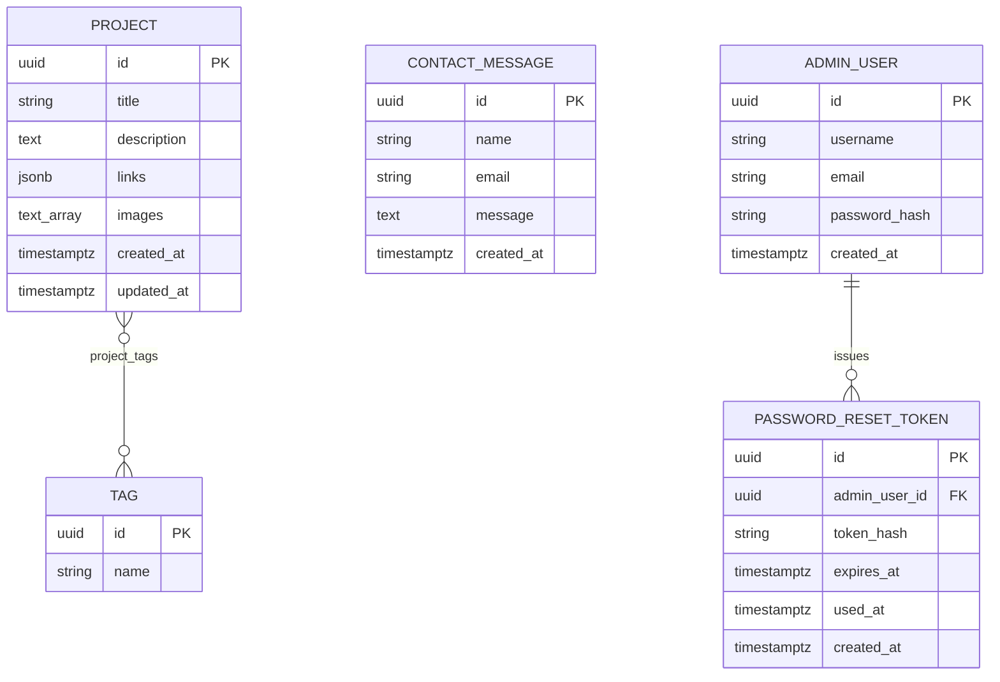
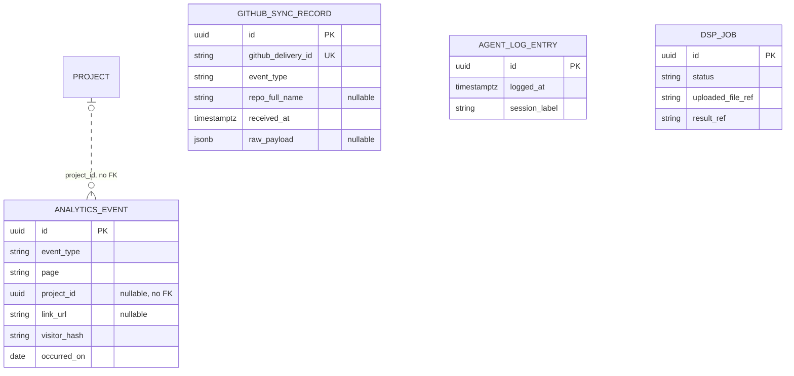

# Data Model

Draft the ER diagram and entity definitions here before writing migrations or JPA entities.

## Conventions (locked 2026-07-24, see `docs/DECISIONS.md`)

- **Primary keys:** `uuid` on every table (app- or DB-generated `gen_random_uuid()` / `uuid_generate_v4()`). Avoids sequential-ID enumeration on public API URLs; consistent with the original ER diagram draft.
- **Timestamps:** `timestamptz`, defaulting to `now()` where the field marks creation time.
- **Images:** plain array of external URL strings - no upload endpoint or storage backend. Admin pastes a link (GitHub raw, image host, etc.).
- **Links:** `jsonb` array of `{label, url}` objects (e.g. `[{"label":"GitHub","url":"..."},{"label":"Live demo","url":"..."}]`) - supports multiple labeled links per project without a join table.

## Core entities

### Project

| Field | Type | Notes |
|---|---|---|
| id | uuid, PK | |
| title | varchar(200), not null | |
| description | text, not null | |
| links | jsonb, not null default `[]` | array of `{label, url}` - see Conventions above |
| images | text[], not null default `{}` | array of external image URLs |
| started_on | date, nullable | when work on the project started; null = unspecified. Added 2026-08-08, see ADR below |
| completed_on | date, nullable | when work finished; **null = ongoing**, a meaningful value rather than missing data. Must not precede `started_on` - enforced at the DTO layer *and* by a table `CHECK` constraint |
| featured | boolean, not null default `false` | first on the public list; never shown (#88) |
| created_at | timestamptz, not null default `now()` | |
| updated_at | timestamptz, not null default `now()` | bump on every update |

**On `started_on`/`completed_on` vs `created_at`/`updated_at`:** these are not duplicates. `created_at`/`updated_at` are *record* timestamps - when the row was entered and last edited. `started_on`/`completed_on` describe *the work itself*, which routinely predates the row by years. Both are `date`, not `timestamptz`: the UI renders month/year only, since the source material can't support day-level accuracy, and the convention is the 1st of the month. Sorting a portfolio by "most recent work" means ordering on these, not on `created_at`.

**The public order** (#88, see `SPEC.md`), for `GET /projects` with or without a tag filter:
`featured` (set only by the admin; GitHub sync never writes it, and the public site never
displays it) first; then, within each half, ongoing (`started_on` set, `completed_on` null), then
completed by latest `completed_on`, then no dates at all; ties by latest `started_on`, then newest
`created_at`, then `id`. The last key makes the order total, so a page boundary can neither
repeat nor skip a project. `created_at` is only a tie-breaker here; the admin list still sorts on
it alone, newest first.

Relationships: many-to-many with `Tag` via join table `project_tags` (`project_id` FK, `tag_id` FK, composite PK, `ON DELETE CASCADE` both sides). Needs pagination/filtering support from the start (Phase 2 - retrofitting later, once real data and a frontend depend on the shape, is the thing to avoid).

**A published project needs at least one tag; a draft may have none** (#148, ADR 2026-10-14). The schema does not hold this: a `CHECK` constraint sees one row, and the tags are rows in `project_tags`. `ProjectService` enforces it on every write, judged on the state the write would leave. GitHub sync's drafts arrive with no tags, so the diagram's zero-or-more `}o--o{` is still right.

### Tag

| Field | Type | Notes |
|---|---|---|
| id | uuid, PK | |
| name | varchar(50), not null, unique | case-insensitive uniqueness (`citext` or a lowercased unique index) to avoid `"React"` / `"react"` duplicates |

Relationships: many-to-many with `Project` via `project_tags` (see above).

**Orphan rows are expected and are not cleaned up.** Nothing deletes a `tag` when its last `project_tags` row goes -- deleting on last-reference is a check-then-act write on state a concurrent project write may be attaching to, the same shape that already produced a race in the tag upsert. Instead `GET /tags` filters to tags with at least one project (`ix_project_tags_tag_id` supports the lookup), so a stale row is invisible through the API and becomes visible again by itself if a project re-attaches the name. The cost is that the table grows monotonically -- tidiness, not correctness. There is no tag-delete endpoint and no tag management UI.

### ~~BlogPost / Writeup~~ - cut from scope (2026-07-21)

Was floated in the original data-model draft; confirmed out of scope in `SPEC.md` → Explicit non-goals. Left here only for traceability - don't implement.

### ContactMessage

| Field | Type | Notes |
|---|---|---|
| id | uuid, PK | |
| name | varchar(200), not null | |
| email | varchar(320), not null | max length per RFC 5321; validate format at the DTO layer, not here |
| message | text, not null | |
| created_at | timestamptz, not null default `now()` | |

**Nothing about the sender's address is stored** (#309). The table used to have a `requester_ip_hash` column, an unsalted SHA-256 of the sender's IP kept for as long as the message, which could be reversed by hashing every IPv4 address; it existed only so the rate limit could count rows. `V10` dropped its index and set every row's value to null, taking the existing hashes with it. The emptied column is still in the table, nullable and unmapped, so that a jar from before #309, which maps it and validates the schema, can still boot if a release is rolled back; #318 drops it in a later release.

Rate limiting: in memory, through `InMemoryRateLimiter` under the key `"contact:" + ClientIpHasher hash`, 5 messages per trailing hour per client IP, as login and password reset are limited. No table and no column. The budget resets when the backend restarts, which is accepted, and deleting messages does not refund it.

### AboutPage (#213, V8)

| Field | Type | Notes |
|---|---|---|
| id | smallint, PK, `CHECK (id = 1)` | the constraint is the singleton: a second row is impossible at the database level |
| body | text, not null default `''` | Markdown, up to 20000 chars (enforced at the DTO layer); empty is the unwritten state, not an error |
| updated_at | timestamptz, not null default `now()` | seeded by the migration, then bumped by `@UpdateTimestamp` only when the body actually changes |

One row, inserted by the migration that creates the table. Deletion is prevented by convention, not constraint -- no code path deletes it, and the service fails loudly (500, naming the migration) if it is gone. A slug-keyed `page` table was considered and not built; the 2026-09-20 ADR in `docs/DECISIONS.md` has the reasoning.

### AdminUser

_Confirmed in scope - see SPEC.md → Auth scope decision._

| Field | Type | Notes |
|---|---|---|
| id | uuid, PK | |
| username | varchar(100), not null, unique | |
| email | varchar(320), not null, unique | **added Phase 2** - the original draft omitted this, but `POST /auth/password-reset-request` (`docs/openapi.yaml`) takes an email and needs somewhere to look it up; added via `V2__admin_user_email_and_seed.sql` alongside the seed row rather than retrofitted into `V1__init.sql` (already shipped in Phase 1/PR #76) |
| password_hash | varchar(255), not null | bcrypt or argon2 - never store plaintext or use a reversible hash |
| created_at | timestamptz, not null default `now()` | |

### PasswordResetToken

_Added 2026-07-24 - see `docs/DECISIONS.md` → Password reset flow ADR. Supports the `POST /auth/password-reset-request` / `POST /auth/password-reset` endpoints in `docs/openapi.yaml`._

| Field | Type | Notes |
|---|---|---|
| id | uuid, PK | |
| admin_user_id | uuid, FK → AdminUser, not null | `ON DELETE CASCADE` |
| token_hash | varchar(255), not null, unique | sha-256 of the reset token - store the hash, never the raw token, same principle as `password_hash`. Unique index added Phase 2 (`V3__password_reset_token_hash_index.sql`) - V1 had no index at all on the column every confirm-reset lookup hits |
| expires_at | timestamptz, not null | 30 minutes from creation - deliberately shorter than the 1-hour JWT session expiry, since a leaked reset token (e.g. via email interception) is a higher-risk artifact than a session token |
| used_at | timestamptz, nullable | set on consumption; a used or expired token must be rejected on `POST /auth/password-reset` |
| created_at | timestamptz, not null default `now()` | |

---

## Phase 7 extension entities

**These are inferred from the Phase 7 feature descriptions in `PROJECT_TODO.md` - the TODO does not specify exact fields. Treat every table below as a draft to confirm or rewrite before implementing, not a settled schema.** GithubSyncRecord and AnalyticsEvent are no longer drafts - see below.

### GithubSyncRecord (7a - GitHub webhook auto-sync)

**Built in Phase 7a (`V6__github_sync_record.sql`, issues #53/#55).** This table is the webhook receiver's *delivery ledger*: it records that a signed delivery arrived and was accepted, and nothing more. It does not yet track "synced repo metadata linked back to a `Project`", which is what the original draft described - that is issue #54, still unbuilt. **What a sync may write is no longer open**: the Phase 7a ADR in `docs/DECISIONS.md` settles it, because the portfolio's prose is hand-curated (#49, `content-seed/projects.json`) and copying a repo description over `Project.description` would destroy it.

**The sync boundary, confirmed 2026-08-18** (Phase 7a ADR): the ledger below and the GitHub-authoritative `Project` columns listed further down are the *only* things an inbound webhook may ever write. `Project.title`, `description`, `tags`, `links`, `images`, `startedOn` and `completedOn` are curated by the owner and never touched by sync.

#### `github_sync_record` - built in 7a

| Field | Type | Notes |
|---|---|---|
| id | uuid, PK | |
| github_delivery_id | varchar(255), not null, unique | GitHub's `X-GitHub-Delivery` header. The unique index `ux_github_sync_record_delivery_id` is *the* idempotency guard: the receiver inserts with `ON CONFLICT DO NOTHING` and treats "0 rows" as a replay, rather than pre-checking for the id and then inserting - that check-then-act shape races two concurrent redeliveries through. Doubles as the supporting index for `findByGithubDeliveryId` |
| event_type | varchar(100), not null | `X-GitHub-Event` - `push`, `release`, `ping`, ... A recorded delivery that doesn't say what kind of event it was is close to useless for #54 |
| repo_full_name | varchar(255), **nullable** | e.g. `user/repo`, read from `repository.full_name` in the verified payload. Nullable, unlike the draft: an organization-level `ping` carries no `repository` object, and a verified delivery must still be recorded or idempotency has a hole exactly where the payload is unusual. NULL means "this delivery named no repo", not "unknown" |
| received_at | timestamptz, not null default `now()` | When the delivery was verified and accepted - a fact this phase knows, unlike `last_synced_at` |
| raw_payload | jsonb, nullable | The delivery body, for debugging a delivery that can't easily be replayed. Content-equal to what arrived but **not byte-equal** - `jsonb` parses rather than stores text, so whitespace goes, keys are reordered and escapes are resolved. It therefore can't be used to re-verify a signature after the fact; nothing needs that, since verification happens once on the wire bytes. The other accepted trade is that a payload containing an escaped NUL can't be stored at all and would fail the insert (see the migration comment) |

Deliberately **not** created yet, both deferred to #54 rather than added speculatively:

| Field | Type | Why not yet |
|---|---|---|
| project_id | uuid, FK → Project, nullable | Which `Project` a delivery belongs to - and whether the link is even by repo name - is part of the open #54 decision. Note that a DB FK here is fine under Spring Modulith (it checks Java package dependencies, not schema), but a JPA `@ManyToOne Project` would not be; store the bare UUID |
| last_synced_at | timestamptz | Phase 7a performs no sync, so every value would be a lie |

#### `project` additions - decided in the 7a ADR, built in #54

Not in `V6`. Listed here so the decision and its schema live together; the migration that adds them is the one that must default existing rows to `published = true`, or a deploy blanks the live site.

| Field | Type | Notes |
|---|---|---|
| repo_full_name | varchar(255), nullable, unique | `user/repo` - what a delivery matches on. Nullable: projects predating 7a, and any that never had a repo |
| published | boolean, not null | Whether the project appears on the public site. Existing rows migrate to **true**; auto-created drafts start **false**. Public endpoints filter on it; admin endpoints do not |
| last_pushed_at | timestamptz, nullable | GitHub-authoritative |
| default_branch | varchar(255), nullable | GitHub-authoritative |
| archived | boolean, not null, default false | GitHub-authoritative. Stored now, not yet rendered |

### AgentLogEntry (7b - rendered agent build-log page)

TODO floats two options: parse `AGENT_LOG.md` directly, or move entries into the DB ("arguably cleaner"). If DB-backed, mirror the `AGENT_LOG.md` entry format:

| Field | Type | Notes |
|---|---|---|
| id | uuid, PK | |
| logged_at | timestamptz, not null | |
| session_label | varchar(255) | |
| task_given | text | |
| agents_used | text[] | e.g. `{backend-agent, frontend-agent}` |
| what_went_wrong | text | |
| how_it_was_caught | text | |
| fix_applied | text | |
| takeaway | text | |

### AnalyticsEvent (7c - custom analytics)

**Decided 2026-10-18** (Phase 7c ADR in `docs/DECISIONS.md`, #72). Privacy constraint from the TODO: no fingerprinting, no third-party trackers, IPs hashed or not stored at all. Here they are hashed under a salt that is never stored, so after its day a row cannot be tied to an address.

#### `analytics_event`

| Field | Type | Notes |
|---|---|---|
| id | uuid, PK | |
| event_type | varchar(20), not null | `page_view` or `link_click`, held by a `CHECK` |
| page | varchar(20), not null | `about`, `projects`, `project`, `contact` or `privacy`, held by a `CHECK`. A closed list, so no path, query string or other free text from the client is stored. A link click's page is always `project` |
| project_id | uuid, nullable, **no FK** | Set exactly when `page` is `project` (a `CHECK`). Checked against the published projects when the event arrives, and kept when the project is later deleted, so its history stays. A foreign key would have to cascade that history away or set it to null, and null rows collide in the unique index below |
| link_url | varchar(500), nullable | Set exactly when `event_type` is `link_click` (a `CHECK`). One of the project's own link URLs at the time of the click; anything else is dropped before insert |
| visitor_hash | char(64), not null | Hex `HMAC-SHA256(salt, ip)`. The salt is random, made per UTC day, held only in memory, and replaced on the first event of the next day |
| occurred_on | date, not null | The UTC day, and the only record of when. The same day the salt belongs to |

**`ux_analytics_event_dedup`**, unique on `(occurred_on, visitor_hash, event_type, page, project_id, link_url) NULLS NOT DISTINCT`. This is the dedup: the insert is `ON CONFLICT DO NOTHING`, so one visitor makes at most one row per page, project, link and day, and two concurrent requests cannot both insert. `NULLS NOT DISTINCT` (Postgres 15+; production runs 16) is what makes two `about` views by one visitor collide, since their `project_id` and `link_url` are both null. `occurred_on` leads, so the same index serves the dashboard's date-range queries.

No retention job: rows are kept.

### DspJob (7d - live DSP/audio demo)

Async job record: build this last, on the `@Async` executor provisioned in Phase 1. Needs strict file size/type limits and a queue, results delivered via polling or WebSocket (not a blocking request).

| Field | Type | Notes |
|---|---|---|
| id | uuid, PK | |
| status | varchar(20), not null | `queued` / `processing` / `done` / `failed` |
| uploaded_file_ref | varchar(500), not null | path/blob reference, with size/type limits enforced before storing |
| result_ref | varchar(500), nullable | |
| created_at | timestamptz, not null default `now()` | |
| completed_at | timestamptz, nullable | |

---

## ER diagram

Core entities (confirmed scope) - `ContactMessage` and `AdminUser` have no FK relationships to `Project`/`Tag`, shown standalone:

Phase 7 entities relate back to `PROJECT` as follows. `GITHUB_SYNC_RECORD` is built (Phase 7a) and shown as implemented - note it has **no** `PROJECT` relationship yet, because the link is issue #54's open decision. `ANALYTICS_EVENT` is decided (Phase 7c), and its line to `PROJECT` is dotted because it is an id with no foreign key. The rest are still speculative - see the caveat above each table - and are not implemented until their sub-phase starts:

(`AgentLogEntry` and `DspJob` have no FK relationship to `Project`, so they're listed but not connected above.)

## Migration notes

- First migration: `V1__init.sql` (Flyway) - should create `project`, `tag`, `project_tags`, `contact_message`, `admin_user`, `password_reset_token`. Phase 7 tables land in their own later migrations, one per sub-phase, not upfront.
- `V2__admin_user_email_and_seed.sql` (Phase 2) - adds `admin_user.email` (see AdminUser table above) and seeds the single admin row with a bcrypt-hashed password, per the Auth Flow ADR in `docs/DECISIONS.md`.
- `V3__password_reset_token_hash_index.sql` (Phase 2) - adds a unique index on `password_reset_token.token_hash` (see PasswordResetToken table above), caught in cross-review after V1/V2 had already shipped without one.
- `V4__project_dates.sql` (Phase 6) - adds nullable `project.started_on` and `project.completed_on` plus a `CHECK` enforcing that `completed_on` neither precedes `started_on` nor exists without it. Additive and non-destructive: both columns are nullable, so existing rows are untouched and no backfill is required. See the 2026-08-08 project-dates ADR in `docs/DECISIONS.md`.
- `V8__about_page.sql` (Phase 6, #213) - creates `about_page` (see AboutPage above) and inserts its one row. Additive; touches nothing existing. V5-V7 (tag index, GitHub sync record, project publication fields) landed with Phase 7a and are described by their own files.
- `V10__clear_contact_message_requester_ip_hash.sql` (#309) - drops `ix_contact_message_ip_hash_created_at`, makes `contact_message.requester_ip_hash` nullable, and sets it to null in every row (see ContactMessage above). Destructive by design: the existing rows' hashes are gone and cannot be restored, and the messages themselves are untouched. The column is kept, with V1's type, so that the release's automatic rollback can still start a jar from before it; #318 drops it once that jar can no longer be rolled back to. V9 (`analytics_event`) is described by its own file.
- `V11__project_featured.sql` (#88) - adds `project.featured boolean NOT NULL DEFAULT false`
  (see Project above). Every existing row reads false, so the flag pins nothing until the admin
  features something, though the same release reorders the public list by period. No new index:
  the file says why. Rollback-safe in the sense of
  `docs/DEPLOYMENT.md`: the previous jar never names the column, and the default fills it on
  that jar's inserts.
- Record schema changes here as they land, or link to migration files directly.
